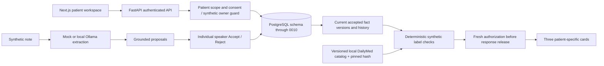

# Architecture and trust boundaries

The new GET `/api/v1/patients/{patient_id}/medication-suitability` requires authentication, an authorized practitioner and an existing `is_demo` patient. Existing authorization is performed before loading facts. Ordinary account-backed patients use existing consent rules; accountless synthetic patients use the existing guarded owner path, not fabricated consent. The new endpoint then refuses ordinary patients, even when they have consent.

`lock_patient_scope` serializes with existing fact/consent operations. The accepted-state loader obtains current versions and history. The pure evaluator rejects foreign patients, inconsistent chains, nonaccepted snapshots and nonsynthetic provenance. Corrections replace earlier versions in the evaluated snapshot while preserving historical records. `ClinicalResponse` rechecks scope and retains locks through response handoff. The bounded synthetic-owner live workflow passed on November 12; dedicated database concurrency/revocation integration validation remains outstanding.

The assessment writes no new clinical records or audit rows and creates no schema. Its response includes assessment time, exact source fact/author/version/provenance, rule ID, source version and catalog SHA-256. These are traceability fields, **not a durable assessment audit trail**. Existing extraction, confirmations, summaries and verification retain their existing persistence/audit behavior.

The LLM is used only in the existing extraction pathway when Ollama is selected. Grounding validates source spans; acceptance remains a human decision. The deterministic demo uses the exact-format mock provider. Neither provider evaluates medication rules.

Next.js renders only validated same-patient responses. Cards are cleared before requests, on context changes and on errors. Abort signals and task generations discard late results after switching patients/signing out. The response rejects foreign fact references and unsupported positive statuses; records/tokens are not newly persisted to browser storage.

M8 review models, service, tests and migration 0011 remain in the tree. `ENABLE_CLINICIAN_FACT_REVIEW` defaults false and prevents route registration, including OpenAPI exposure. No migrations run at FastAPI startup. Enabling this flag is a later reviewed deployment decision, not part of the capstone.
