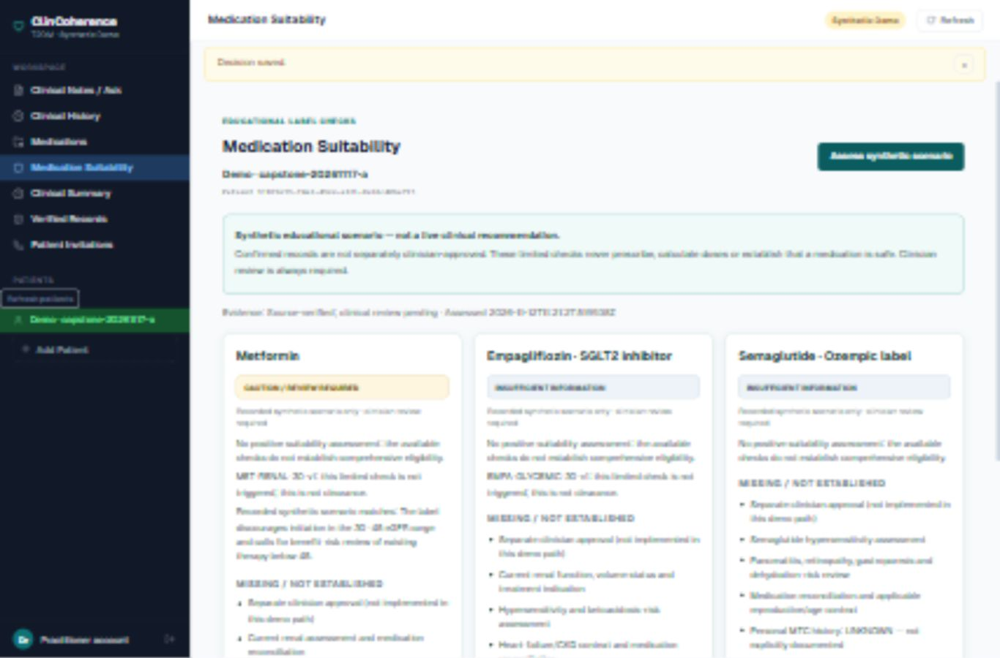
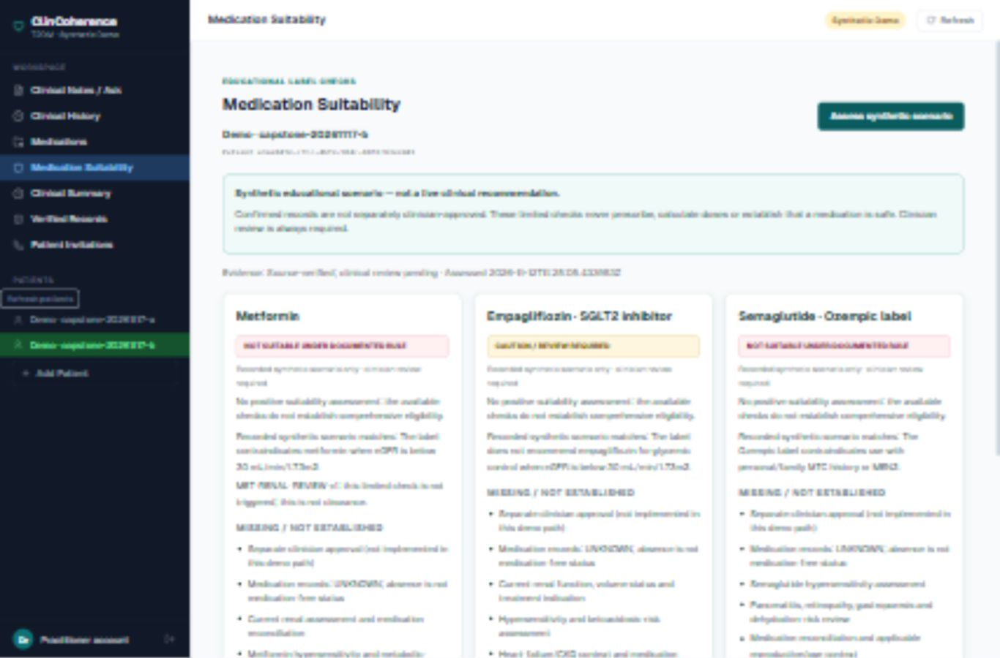

# Controlled live rehearsal — November 12, 2026

**PASS — ready for the rehearsed desktop, synthetic-only capstone workflow.** This was an actual browser-to-FastAPI-to-PostgreSQL rehearsal, not a mocked browser test. The user entered the existing practitioner's password privately. No credential was retrieved, reset or recorded.

## Verified environment

- Repository branch: `codex/m8-clinician-fact-review`.
- Configured database: `localhost:5432/clincoherence_db`, with no URL query overrides. Read-only preflight/postcheck connections pinned the host to `127.0.0.1` and verified the server-reported database, address, port and read-only transaction state.
- PostgreSQL version number: `180006`. Alembic revision before and after: **`0010_clinical_summary_release`**. No migration was run.
- Existing `doctor-demo@synthetic.invalid` account: active practitioner with an authorized practitioner profile. Creation used the existing guarded synthetic-owner UI/API path. The postcheck independently confirmed ownership and accountless synthetic profile invariants for both created patients.
- Controlled backend: `127.0.0.1:8001`; frontend: `127.0.0.1:3000`, explicitly proxied to 8001. Port 8000 was already occupied; its process was neither reused nor stopped.
- Process settings: `APP_ENV=development`, `ENABLE_DEMO_PATIENTS=true`, `ENABLE_DEMO_REGISTRATION=false`, **`ENABLE_CLINICIAN_FACT_REVIEW=false`**, **`LLM_PROVIDER=mock`**. Localhost resolution was checked for loopback addresses before startup.
- API health and frontend proxy passed. M8 routes were absent from OpenAPI. An unauthenticated assessment request returned 401.
- Browser: Codex in-app browser, temporarily set to 1366 × 900 for usable desktop navigation. The temporary override was reset afterward.

## Actual results

| Requested step | Result | Observed evidence |
|---|---|---|
| 1. Login and patient selection | PASS | User signed in privately; practitioner workspace and guarded demo creation became available. Both named patients could be selected. |
| 2. Extraction and individual Accept/Reject | PASS | A produced six proposals: five individually confirmed and fatigue rejected. B produced four proposals, all individually confirmed. Persisted provenance identified `mock@explicit-v1`. |
| 3. History, Medications, Summary | PASS | A's history showed exact patient/fact/version IDs and synthetic source provenance; medication panel showed metformin. Summary showed HbA1c 8.2 → 7.6 and eGFR 42. B's summary showed HbA1c 8.8, eGFR 25, missing previous HbA1c and no medication records. |
| 4. Verified Records and grounded questions | PASS | A's selected February HbA1c produced a technically verified 7.6% restatement. Latest-HbA1c questions returned 7.6% for A and 8.8% for B. A's symptom question returned no matching accepted record, explicitly without inferring absence. |
| 5. Three cards, evidence and cautions | PASS | All three cards rendered live. Expanded references displayed rule IDs, bound fact versions, DailyMed SPL versions/sections and clinical-review-pending status. UNKNOWN and safety limitations remained visible. |
| 6. Different patient-specific results | PASS | A: metformin caution; empagliflozin and semaglutide insufficient information. B: metformin and semaglutide not suitable under documented rule; empagliflozin glycemic-control caution. |
| 7. Switching without stale/cross-patient content | PASS for observed live switching | A's records/questions did not carry into B. B → A → B cleared existing cards and required an explicit fresh assessment; A's caution returned correctly after switching back. A rapid reassessment/switch also showed no retained result. B's expanded fact versions were its own four records, not A's HbA1c/eGFR versions. |

The live switching check did not deliberately hold a network response or simulate every concurrent race. Previously executed mocked browser tests cover delayed-response cancellation; this rehearsal does not replace database concurrency/security integration tests or validate M8.

## Authorized persisted data

| Scenario | Identifier | Patient ID | Notes | Confirmation decisions | Accepted fact versions |
|---|---|---|---:|---|---:|
| A | `capstone-20261117-a` | `9fb99e59-74a2-49dd-a321-0a36c406a715` | 1 | 5 CONFIRMED, 1 REJECTED | 5 |
| B | `capstone-20261117-b` | `a3ea045d-c7cc-467d-904c-8876fb3ed441` | 1 | 4 CONFIRMED | 4 |

The final read-only query verified those counts, synthetic origin, mock provenance and ownership. Normal application-generated verification/summary/question audit/release records were also allowed by the rehearsal and created through their existing UI flows; their total was not separately counted. No existing record was corrected, overwritten or deleted. Queries and UI changes were restricted to these synthetic patients and the existing synthetic practitioner.

## Remaining presentation risks and boundaries

1. **Narrow layout fails navigation:** at the embedded browser's initial 319-pixel width, the sidebar was hidden and no alternate patient-navigation control appeared. Existing CSS hides it at widths of 680 pixels or less. Use a full desktop browser wider than 680 pixels; 1366 × 900 was rehearsed. No CSS/code fix was made.
2. **Port 8000 is occupied:** use the rehearsed backend on 8001, and keep the frontend's `BACKEND_ORIGIN=http://127.0.0.1:8001`. Do not silently point the frontend at the unrelated/unverified existing listener on 8000.
3. **Presentation preparation:** sign in privately before projecting; sessions are memory-only and expire. The functional flow passed, but a timed 7–10 minute speaking rehearsal remains useful. Reuse the prepared accepted patients for review; do not resubmit their notes and create duplicate observations. A new live extraction performance needs a separately named synthetic record under the user's authorized scope.

Source verification is not independent clinical approval. These cards remain synthetic educational label checks, not prescriptions or live clinical recommendations. Clinical review, comprehensive contraindication/interactions evaluation and M8 database validation remain outside this rehearsal.

No `.env` file, application code, migration, unrelated database, paused disposable cluster/PID file or Git history was modified. Only rehearsal documentation/screenshots were added or updated in the workspace. The controlled frontend/backend were left running for review; the existing PostgreSQL service and port-8000 process were left untouched.

## Captures from the actual rehearsal

Saved under `live-rehearsal-2026-11-12/`: A provenance, summary, verified record, grounded questions, medication cards and label evidence; B summary and medication cards. These are live synthetic screenshots, distinct from earlier mocked test captures. The small text in exported screenshots may need a fresh full-size capture for projection; the text report records the exact verified outcomes.

